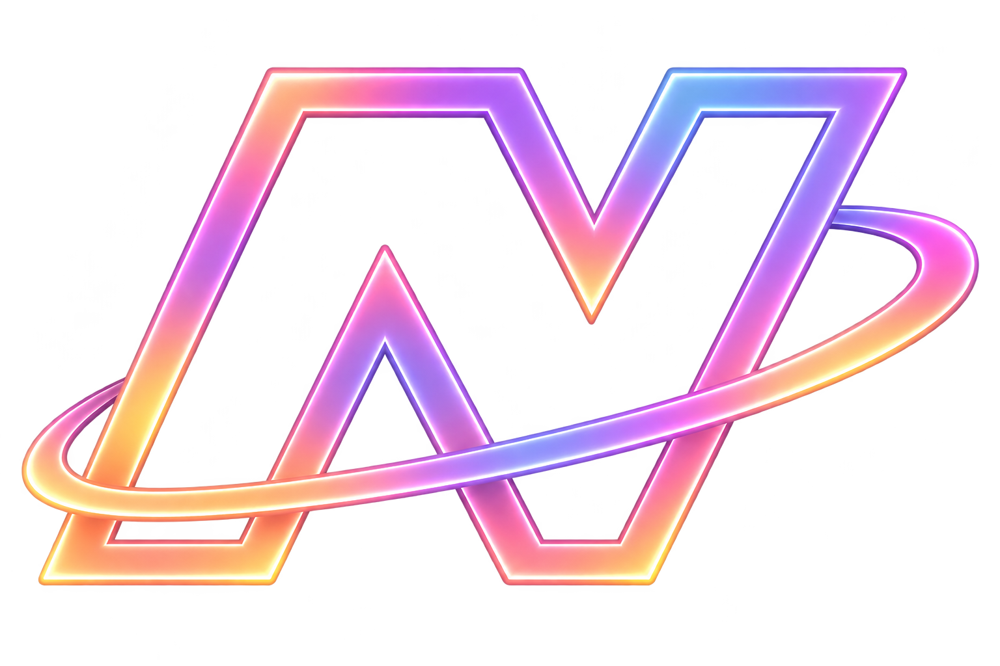

<p align="center">
  
</p>

<h1 align="center">Nebula · GTA VI Edition</h1>

<p align="center">
  A fullscreen Windows launcher for a local GTA VI package and community VIctory builds.
</p>

<p align="center">
  <a href="#getting-started">Getting started</a> ·
  <a href="#runtime-builds">Runtime builds</a> ·
  <a href="#building-from-source">Building from source</a> ·
  <a href="#independence-and-distribution">Independence</a>
</p>

---

Nebula keeps game setup, runtime selection, and shader preparation in one place. Choose your local package, install a VIctory build, and switch between installed builds from the same launcher.

> [!IMPORTANT]
> VIctory compatibility is experimental. Startup and gameplay depend on the title package, GPU, driver, and runtime build. Nebula provides the launcher and does not supply the game.

## Getting started

1. Extract the Windows x64 release and open **Nebula-GTAVI-Version.exe**. Install [Microsoft Edge WebView2](https://developer.microsoft.com/microsoft-edge/webview2/#download-section) if the dashboard cannot open.
2. In **Game setup**, choose the root folder of the local GTA VI Xbox Series package you are authorized to use. Nebula detects the executable in that folder.
3. Under **VIctory builds**, use **Install Git** and **Install Rust** if needed. Install [Visual Studio Build Tools](https://visualstudio.microsoft.com/visual-cpp-build-tools/) with **Desktop development with C++** and a Windows SDK.
4. Select **Install** beside a runtime. Nebula fetches its pinned source revision from GitHub and builds it locally. When it finishes, the build appears in the **Compatibility runtime** selector.
5. Select an installed runtime and choose **Launch**. When pre-warming is needed, the launcher shows progress and saves the translated shaders for later launches with that build.

## Runtime builds

| Build | Pinned revision |
| --- | --- |
| **VIctory World** | [ZSlayerHQ · `99f8834`](https://github.com/ZSlayerHQ/zslayer-pc-port-runtime/commit/99f8834aa16b98d7f3943b8de262a8d4857bda7b) |
| **Nvidia 8g** | [soldsawn · `a14d8c8`](https://github.com/soldsawn/victory-nvidia-8gb/commit/a14d8c88c12dfb00e0c0361b99d3d44addc620de) |
| **VIctory AMD** | [myokex · `070df42`](https://github.com/myokex/victory-amd/commit/070df424b0967dca422478a1f12afaaf6736ebdd) |

Runtime builds can take several minutes. Nebula stores settings, installed runtimes, and caches in `%LOCALAPPDATA%\Nebula-GTAVI`. Launch logs are under `VIctory\launcher-logs` in that directory.

## Building from source

Use Windows 11 with the .NET 8 SDK and PowerShell 7. The launcher builds independently of the optional runtime repositories.

```powershell
dotnet run --project .\Nebula-GTAVI.csproj
```

To produce a self-contained Windows x64 ZIP and SHA-256 checksum, run the release script from the repository root. Its output goes to `release/`.

```powershell
.\tools\Publish-NebulaRelease.ps1 -Version 0.1.0-preview.2
```

## Independence and distribution

Nebula is an independent community project. It is not affiliated with, endorsed by, or sponsored by Rockstar Games or Take-Two Interactive. Grand Theft Auto and related marks belong to their respective owners.

This repository distributes launcher source, Nebula interface assets, and VIctory integration patches. The release ZIP contains the launcher and its desktop dependencies. Neither contains GTA VI game files, executable builds, keys, saves, shader caches, or compatibility runtime binaries. Nebula does not download a title package.

VIctory integration patches are supplied with the [upstream GPL-3.0 license text](licenses/VIctory-GPL-3.0.txt). The bundled HLS.js component has its [own license notice](Dashboard/vendor/hls.js-LICENSE.txt).
